# 06 — Agent Nebula Registration & Discovery

This is the first example that crosses the boundary from standalone A2A into the Agent Nebula enterprise trust domain.

[agentnebula.ai](https://agentnebula.ai/) provides the **Registry** used to establish publisher/provider ownership, register Agent Cards and capabilities, and discover agents. Later examples add Agent Nebula **OAuth** and **Policy** enforcement. A2A remains the agent-to-agent protocol; Agent Nebula supplies enterprise identity, trust, discovery, authorization, and lifecycle controls around it.

Unlike Examples 01–05, Example 06 does **not** create a self-signed/local-CA server certificate. The agent creates its private key and CSR locally. The CSR is submitted to Agent Nebula under the Provider account, and Agent Nebula supplies the signed certificate and trust bundle. The private key never leaves the agent host.

## 1. Create and verify the Publisher account

Open [Agent Nebula](https://agentnebula.ai/) → **Identity & Trust** → **Create account**. Select **Email OTP** or **Phone OTP**, then enter the publisher email/phone, publisher name, and password. Select **Register and send OTP**. The screenshots below demonstrate email verification; phone verification is an alternative when available.

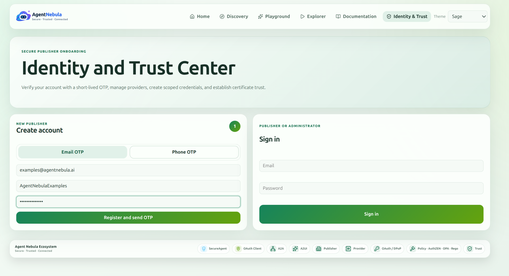

Enter the six-digit registration code delivered to the selected channel and choose **Activate account**. The email verification screen indicates that the code expires in five minutes; use **Resend code** if necessary.

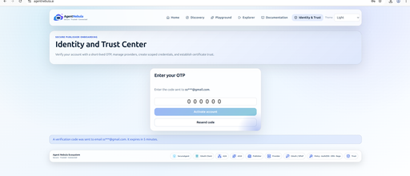

After activation, the interface confirms **Account activated. You can now sign in.**

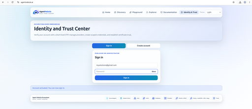

## 1a. Sign in and complete required MFA

Choose **Sign in** and enter the publisher email and password.

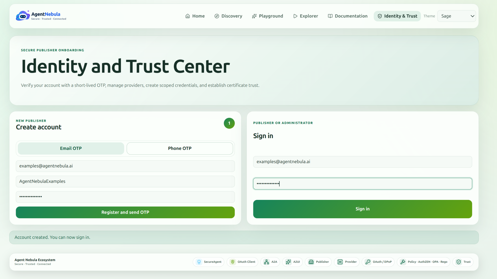

The sign-in flow requires a separate six-digit verification code sent to the registered channel. Enter it under **Verify sign in** and select **Verify and sign in**. This is **not** the earlier registration OTP.

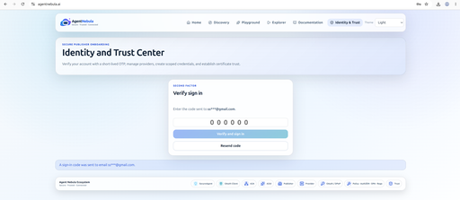

On first access, Agent Nebula requires authenticator enrollment before opening the publisher workspace. Confirm the current password and select **Start setup**.

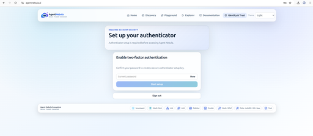

Open Google Authenticator or another compatible TOTP application. Scan the displayed QR code **or** enter its manual setup key into the app. Then enter the current six-digit authenticator code and select **Verify and enable**. The authenticator uses time-based codes that refresh every 30 seconds.

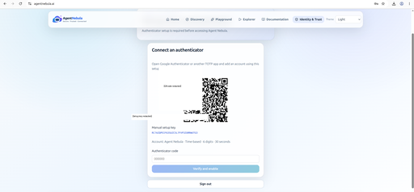

The QR code and setup key are intentionally redacted in this documentation. **Never publish or share your own authenticator enrollment QR code, setup key, password, or OTP.** Registration verification, sign-in OTP, and authenticator TOTP are distinct steps. Complete any additional prompts presented by the application before continuing to Providers.

## 2. Create a Provider

Open **Providers** in the publisher workspace and select **Create Provider**.

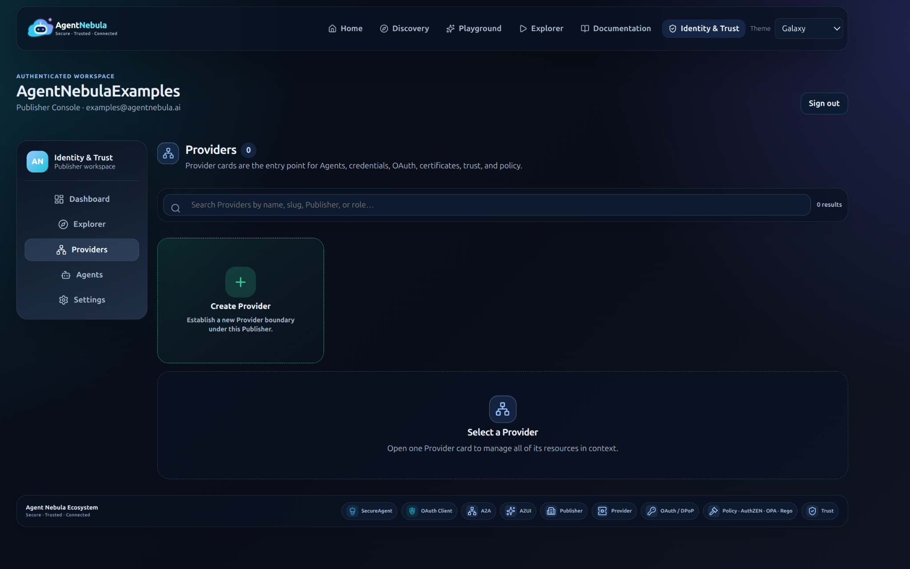

Enter a provider name, slug, and URL. The Provider is the organizational boundary that owns the example agent, credentials, OAuth configuration, certificates, trust, and policy.

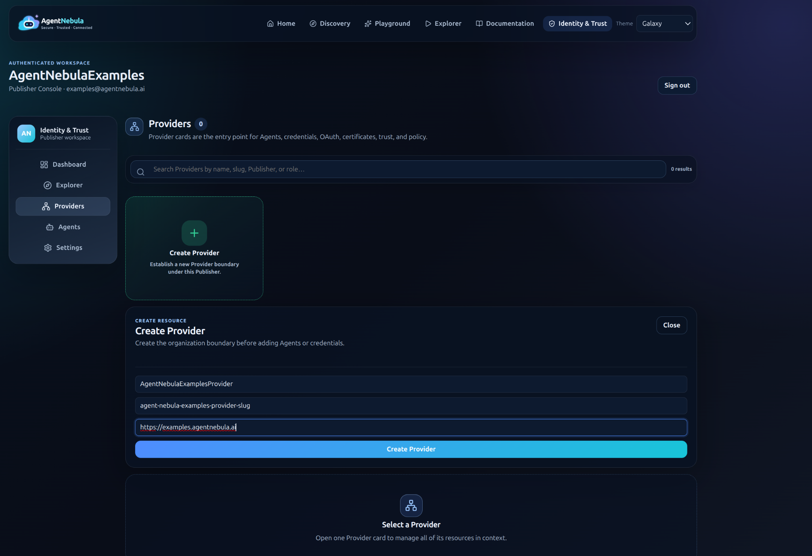

After creation, open the Provider workspace.

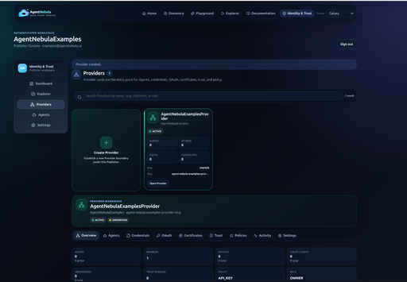

## 3. Generate the agent private key and CSR

From the repository root run:

```bash
make nebula-pki-init
```

`make nebula-pki-init` generates reusable Agent Nebula enrollment keys and CSRs outside the disposable example runtime:

```text
$AGENT_NEBULA_EXAMPLES_ROOT/nebula-certs/
├── server.key
├── server.csr
├── client.key
└── client.csr
```

The command does not self-sign or fabricate Agent Nebula certificates.

Inspect/copy the CSR with:

```bash
cat $AGENT_NEBULA_EXAMPLES_ROOT/nebula-certs/server.csr
```

Do **not** upload `$AGENT_NEBULA_EXAMPLES_ROOT/nebula-certs/server.key`. The private key must remain on the agent host.

The generated development CSR contains `localhost` and `127.0.0.1` SANs because this example advertises `https://localhost:9006/`. For a remotely reachable deployment, generate the CSR for the hostname/IP actually advertised by the Agent Card.

## 4. Submit the CSR and obtain Agent Nebula trust

Open the Provider and select **Certificates**. Paste the complete contents of `$AGENT_NEBULA_EXAMPLES_ROOT/nebula-certs/server.csr` into **Certificate signing request** and submit it.

Use **Download Agent Nebula trust root** to obtain the Agent Nebula trust bundle.

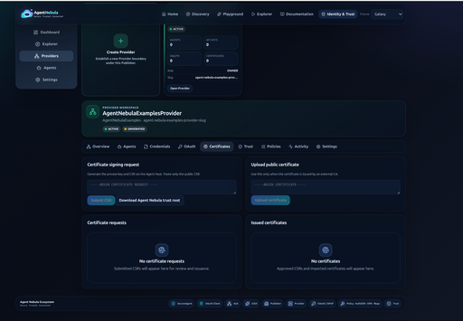

After the CSRs are approved/issued, install the Agent Nebula certificates and trust bundle as:

```text
$AGENT_NEBULA_EXAMPLES_ROOT/nebula-certs/server.crt
$AGENT_NEBULA_EXAMPLES_ROOT/nebula-certs/client.crt
$AGENT_NEBULA_EXAMPLES_ROOT/nebula-certs/trust-bundle.pem
```

The durable Agent Nebula TLS layout is:

```text
$AGENT_NEBULA_EXAMPLES_ROOT/
├── nebula-certs/
│   ├── server.key
│   ├── server.csr
│   ├── server.crt
│   ├── client.key
│   ├── client.csr
│   ├── client.crt
│   └── trust-bundle.pem
└── secrets/
    └── onboarding-api-key
```

`make init example-06` copies `nebula-certs/` into `runtime/example-06/certs/`; the application never reads enrollment material directly from the durable directory.

`config/a2aserver.conf`, `config/a2aclient.conf`, and `config/nebula.conf` are already configured to use these managed runtime paths.

## 5. Generate the onboarding API key

In the same Provider workspace, open **Credentials** and create an API key with the permissions required to onboard/register this agent. Store the returned secret locally as:

```text
$AGENT_NEBULA_EXAMPLES_ROOT/secrets/onboarding-api-key
```

Protect it as a secret:

```bash
chmod 600 $AGENT_NEBULA_EXAMPLES_ROOT/secrets/onboarding-api-key
```

Alternatively, rerun initialization with the API key in the environment:

```bash
export NEBULA_ONBOARDING_API_KEY='...'
make secrets-init
unset NEBULA_ONBOARDING_API_KEY
```

`make secrets-init` writes the value into `$AGENT_NEBULA_EXAMPLES_ROOT/secrets/onboarding-api-key`; it does not place the API key in a configuration file.

## 6. Verify configuration before starting

Before runtime initialization, the example expects:

```text
$AGENT_NEBULA_EXAMPLES_ROOT/nebula-certs/server.key
$AGENT_NEBULA_EXAMPLES_ROOT/nebula-certs/server.crt
$AGENT_NEBULA_EXAMPLES_ROOT/nebula-certs/client.key
$AGENT_NEBULA_EXAMPLES_ROOT/nebula-certs/client.crt
$AGENT_NEBULA_EXAMPLES_ROOT/nebula-certs/trust-bundle.pem
$AGENT_NEBULA_EXAMPLES_ROOT/secrets/onboarding-api-key
```

After installing the approved certificates and onboarding API key, initialize the runtime snapshot:

```bash
make init example-06
```

The default Registry URL is `https://localhost:8000`. Update `config/nebula.conf` if Agent Nebula is running elsewhere. The Registry must also be able to reach the Agent Card URL advertised by `config/a2aserver.conf`.

## 7. Run the registration/discovery acceptance test

Start the provider:

```bash
make run example-06 server
```

The server should start over HTTPS and register its Agent Card/capabilities with Agent Nebula using the onboarding API key.

In another terminal run:

```bash
make run example-06 client
```

The client must discover the provider through Agent Nebula Registry by capability and then invoke all three A2A skills (`hello`, `echo`, and `add`). It must not depend on a hard-coded provider URL for discovery.

## Trust relationship established by this example

```text
Agent host                           Agent Nebula
──────────                           ────────────
Generate private key
Generate CSR  ─────────────────────► Provider / Certificates
                                     Sign certificate
             ◄───────────────────── Signed certificate
             ◄───────────────────── Trust bundle

Install certificate
Keep private key local
Install trust bundle
Install onboarding API key
        │
        └──────── HTTPS + trusted registration ────────► Registry
```

Example 06 is successful only when certificate trust, authenticated registration, Registry discovery, and subsequent A2A skill invocation all work together.

## Shared hosted-platform guides

See [onboarding and registration](../../docs/NEBULA_REGISTRATION.md), [OAuth/policy tests](../../docs/NEBULA_OAUTH_POLICY.md), and [public endpoint prerequisites](../../docs/NEBULA_NGROK_NGINX.md).
